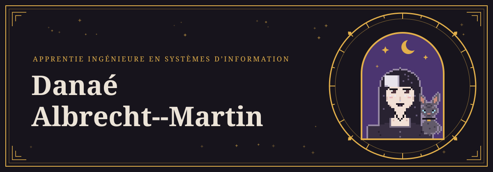
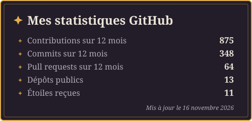
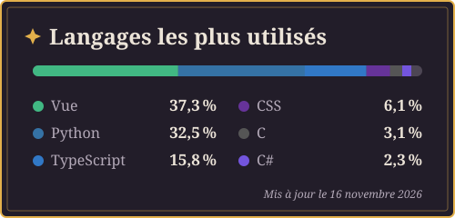

<a href="https://danaedev.fr">
  <picture>
    <source media="(prefers-color-scheme: dark)" srcset="assets/banniere-sombre.svg">
    <source media="(prefers-color-scheme: light)" srcset="assets/banniere-clair.svg">
    
  </picture>
</a>

  
  
  

## ✦ À propos

Je conçois des applications du design system jusqu’à la mise en production, avec l’accessibilité comme fil conducteur.

- 🎓 Cycle ingénieur en systèmes d’information au **CNAM**, en alternance à la **Collectivité européenne d’Alsace**
- 🔭 En ce moment : mes **[polices libres](https://polices.danaedev.fr)**, dessinées en Python et publiées sur npm
- 🌏 Dernier stage : **[λLens](https://lambdalens.danaedev.fr)**, au Biophotonics Engineering Lab de l’Université Yonsei, à Séoul
- 🐈‍⬛ Le chat sur la bannière s’appelle Thanos, et le titre est écrit en Sorcelle, une de mes polices
- 📫 Disponible dès **septembre 2027**

## ✦ Technos

<table>
  <tr>
    <td><b>Interfaces web</b></td>
    <td></td>
  </tr>
  <tr>
    <td><b>Back-end et données</b></td>
    <td></td>
  </tr>
  <tr>
    <td><b>Mobile, système et jeux</b></td>
    <td></td>
  </tr>
  <tr>
    <td><b>Design et livraison</b></td>
    <td></td>
  </tr>
</table>

## ✦ Projets à la une

<table>
  <tr>
    <td width="50%" valign="top">
      <h3><a href="https://lambdalens.danaedev.fr">λLens</a></h3>
      Compare sur des graphiques interactifs les figures de mérite extraites d’articles scientifiques.  
      <code>Vue 3</code> <code>Tailwind CSS 4</code> <code>Python</code> <code>Docker</code> 
      <a href="https://github.com/dalbrechtmartin/Yonsei-Lab-Internship">Voir le code</a>
    </td>
    <td width="50%" valign="top">
      <h3><a href="https://polices.danaedev.fr">Polices de Danaé</a></h3>
      Mes polices libres : catalogue avec recherche, essai en ligne et paquets npm.  
      <code>Python</code> <code>fontTools</code> <code>HarfBuzz</code> <code>GitHub Actions</code> 
      <a href="https://github.com/dalbrechtmartin/fonts">Voir le code</a>
    </td>
  </tr>
  <tr>
    <td width="50%" valign="top">
      <h3><a href="https://github.com/dalbrechtmartin/Wiccards">Wiccards</a></h3>
      Appli Android de révision par flashcards, en Jetpack Compose avec une architecture MVVM.  
      <code>Kotlin</code> <code>Jetpack Compose</code> <code>MVVM</code> 
      <a href="https://github.com/dalbrechtmartin/Wiccards">Voir le code</a>
    </td>
    <td width="50%" valign="top">
      <h3><a href="https://rebmap.itch.io/eclatax">Eclatax</a></h3>
      Jeu à deux sur un clavier, fait en équipe de 5 pendant la Global Game Jam 2025.  
      <code>Godot</code> 
      <a href="https://rebmap.itch.io/eclatax">Jouer sur itch.io</a>
    </td>
  </tr>
</table>

Tous mes projets sont sur **[danaedev.fr](https://danaedev.fr/#projets)**.

## ✦ Statistiques

  <picture>
    <source media="(prefers-color-scheme: dark)" srcset="assets/stats-sombre.svg">
    <source media="(prefers-color-scheme: light)" srcset="assets/stats-clair.svg">
    
  </picture>
  <picture>
    <source media="(prefers-color-scheme: dark)" srcset="assets/langages-sombre.svg">
    <source media="(prefers-color-scheme: light)" srcset="assets/langages-clair.svg">
    
  </picture>

<picture>
  <source media="(prefers-color-scheme: dark)" srcset="https://github-readme-activity-graph.vercel.app/graph?username=dalbrechtmartin&custom_title=Contributions%20des%2030%20derniers%20jours&bg_color=221d29&color=ece4d8&title_color=e3b04b&line=b99af5&point=e3b04b&area=true&area_color=4b3570&hide_border=true&radius=6">
  <source media="(prefers-color-scheme: light)" srcset="https://github-readme-activity-graph.vercel.app/graph?username=dalbrechtmartin&custom_title=Contributions%20des%2030%20derniers%20jours&bg_color=fbf6ea&color=1d1822&title_color=8a5a00&line=6b3fb5&point=8a5a00&area=true&area_color=d9c9f0&hide_border=true&radius=6">
  
</picture>

## ✦ Me contacter

Le plus simple : **[contact@danaedev.fr](mailto:contact@danaedev.fr)**. Mes composants sont aussi sur [Uiverse](https://uiverse.io/profile/dalbrechtmartin).

Bannière et cartes générées par [`scripts/generer_images.py`](scripts/generer_images.py) avec le design system de [danaedev.fr](https://danaedev.fr).
